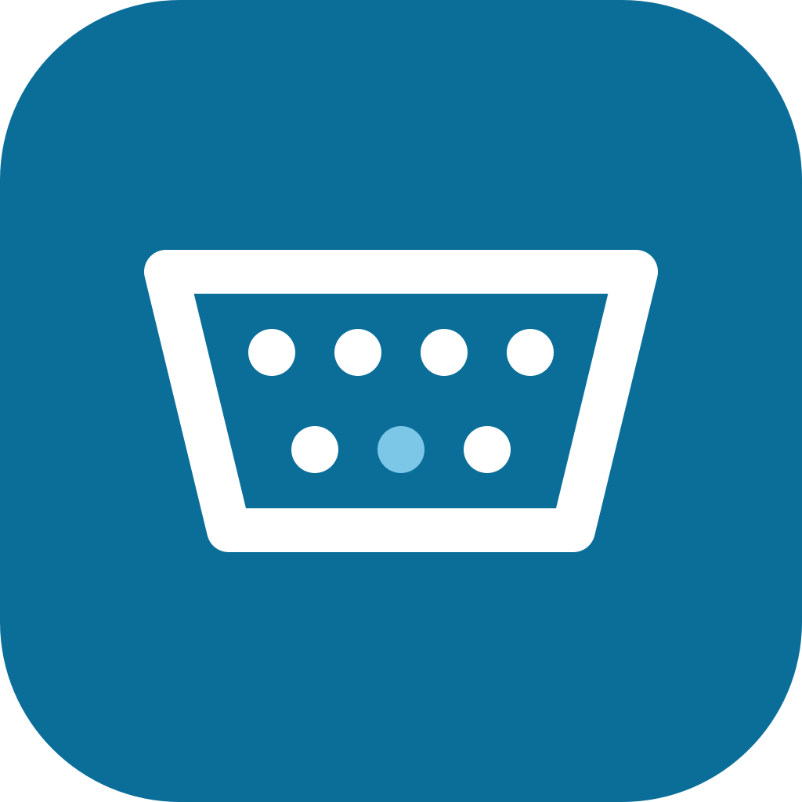

# OpenPlug

> Open-source replacement for the **ŠKODA Connect LITE** app, talking to the
> Bluetooth OBD dongle *Škoda DataPlug by TEXA*. Clean-room, interoperability-only.

**🚧 Under active development — contributions welcome.** It reads live values from a
real dongle on Android (Bluetooth Classic), on iPhone and on macOS (BLE), and keeps a
trip log with routes on top of them. See [Status](#status),
[What the apps do](#what-the-apps-do) and [Contributing](#contributing).

ŠKODA discontinued the Connect LITE app on 1 July 2025. The **DataPlug hardware
still works** — only the app that drove it is gone. OpenPlug is a clean,
cross-platform (Android + iOS) reimplementation of the phone↔dongle protocol so
the dongle you own stays usable.

It talks to the dongle **locally over Bluetooth** — no account, no server, no cloud.
The only secret needed is the **PIN printed on the dongle's label**, which the owner
has.

**Not affiliated with or endorsed by Škoda, Volkswagen or TEXA.** It reimplements an
*interface* for interoperability with hardware the user owns; it contains no vendor
code, firmware, keys or trademarks.

## What it reads

Decoded from live traffic on our own car (see
[`research/notes/live_protocol.md`](research/notes/live_protocol.md)):

**odometer · range · fuel in tank · average consumption · vehicle speed · engine
speed · coolant, oil & intake-air temperatures · battery voltage · throttle position ·
time & distance since the last service** — the full catalog is in the note above.

The app *subscribes* to a signal at a chosen rate and the dongle streams updates;
OpenPlug reimplements exactly that read path, and — like the original app — builds
the trip log and statistics on the phone from those values.

## Background

- [**What ŠKODA Connect LITE was**](research/notes/connect_lite_overview.md) — the
  retired app this project replaces, and its features.
- [**What the DataPlug by TEXA is**](research/notes/dataplug_hardware.md) — the
  Bluetooth-to-CAN/OBD dongle it talked to.

## How the dongle works (reverse-engineered from our own device + traffic)

```
Bluetooth            →  TLS-SRP tunnel         →  protobuf            →  the car
Classic SPP (Android)    TLS 1.2, SRP-6a,          subscribe to a          the dongle is a
or BLE (iOS, macOS)      cipher 0xC01D,            parameter group,        CAN/OBD gateway
                         identity "PA",            get a stream of
                         password = label PIN      data objects
```

No server is involved — everything is local between phone and dongle. The dongle is
dual-mode Bluetooth (FCC ID T8RDP15/T8RDP22), so no MFi is required. Both sides carry
the same bare TLS records: on Classic they travel on the serial channel; on BLE each
record is written to one characteristic and read back from it after a one-byte
notification ([`ble_transport.md`](research/notes/ble_transport.md)).

## Status

The protocol stack has run against a real dongle in a real car on all three clients
(2026-11-13). Everything built on top since then has been exercised against stand-ins
for the dongle (a fake dongle over TCP and over BLE, mocked positions) on real phones
and in the simulator — **not yet on a real drive**.

| Piece | Where | State |
|---|---|---|
| Protocol core (Rust) | [`core/`](core/) | ✅ TLS-SRP tunnel + read path, against a real dongle; trip log, recording and routes by offline tests |
| Android app | [`android/`](android/) | ✅ live values from a real dongle (Classic SPP); the rest against the fake dongle |
| BLE transport (Swift) + macOS CLI | [`apple/`](apple/) | ✅ live values from a real dongle over BLE |
| iOS / macOS app (SwiftUI) | [`apple/App/`](apple/App/) | ✅ live values from a real dongle on an iPhone; the rest against the fake dongle |
| Desktop harness, fake dongles, replay | `core/examples/`, `apple/Sources/openplug-fake-ble/` | ✅ for development without a car |

## What the apps do

Both apps have the same three tabs.

- **Car** — while connected: speed, engine speed and the trip in progress, fuel and
  range, odometer, temperatures, battery. While the car is away: its **last known
  state** with the time it was seen, the last trip, the time and distance since the
  last service, and (with routes on) where it is **parked**, on a map.
- **Trips** — a **trip log** kept by the phone: a summary for the last 7 days, the
  month or the year; trips by day with **refuels** in between; a trip's detail with its
  numbers and, with routes on, its **route on a map** and the speed along it.
- **Settings** — the dongle and its PIN, running in the background, routes, value
  recordings, every live signal the dongle streams, CSV export of the trips.

Around that:

- **Hands-off recording.** Once connected the session stays on: it waits for the car,
  reconnects when the ignition comes on — from the background, after the system ended
  the app, after a reboot — and records the drive.
- **The trip in progress at a glance**: a Live Activity on iOS (lock screen, Dynamic
  Island), a live notification on Android (a Live Update on Android 16+).
- **Routes are opt-in.** The phone's position is taken only while the car is connected,
  stays on the device, and is never written to value recordings.
- **Record and replay.** A session's value stream can be recorded and replayed later at
  the desk, into the trip log or out of the fake dongle.

Not there yet: trip notes and types, addresses, driving score, the warning-light and
AdBlue groups, the dongle's token authentication (the PIN is used on every connect),
and the raw OBD/UDS request path. What the original app offered, feature by feature,
is in [`original_app_features.md`](research/notes/original_app_features.md).

## Architecture

A shared **Rust core** does all protocol work; each platform adds a small Bluetooth
transport and a thin native UI, bound through UniFFI.

```
Compose UI (Android)              SwiftUI (iOS, macOS) / CLI (macOS)
BluetoothSppTransport             CoreBluetoothTransport
        └──────── ByteTransport (UniFFI) ────────┘
                    openplug-core (Rust)
   link → dongle (protobuf) → tls_client / tls_record / srp → bytes
   journal (trips, refuels, routes, last values) · recording (record / replay)
```

| Core module | Role |
|---|---|
| `srp`, `tls_prf`, `tls_handshake`, `tls_record`, `tls_client` | the TLS-SRP tunnel: SRP-6a (RFC 5054), TLS 1.2 with Encrypt-then-MAC (RFC 7366) and Extended Master Secret (RFC 7627), AES-128-CBC + HMAC-SHA1. Pure Rust, no C dependency |
| `protobuf` | schema-less protobuf wire codec |
| `dongle` | the application protocol: Subscribe request, DataElement decode, signal catalog |
| `journal` | trips and refuels from the value stream (start, pause, resume, finish; JSON file), the car's last known values, and — from position fixes — each trip's route and the parking place |
| `recording` | records the value stream to a file and replays it into a journal |
| `link` | the read API: connect → authenticate → subscribe → stream of values |
| `ffi` | the UniFFI facade for Kotlin and Swift (feature `ffi`) |
| `transport` | the byte-channel trait, an adapter for any `Read + Write`, a test pipe |
| `dtp` | a framing found in the vendor library; not used on the wire by either transport |

## Build & run

**Core, offline (no dongle needed):**

```sh
cd core
cargo test --features ffi
```

**End to end without a car** — a stand-in dongle with synthetic values, for any number
of clients at once:

```sh
cd core
cargo run --example fake_dongle                                      # terminal 1
OPENPLUG_PIN=1234 cargo run --example live -- --tcp 127.0.0.1:4455   # terminal 2
```

Debug builds of both apps can connect to it (see their READMEs); for an iPhone over
real BLE, `apple/Sources/openplug-fake-ble` makes a Mac stand in for the dongle.

**Record a drive, replay it at the desk.** With **Record values** switched on (the
default in debug builds), both apps write each session's value stream to a file
(JSON Lines: link up/down and every message with its time; no position, no VIN —
format in [`core/src/recording.rs`](core/src/recording.rs)). `live --record FILE`
does the same from a computer. A recording can then be

```sh
cd core
cargo run --example replay -- drive.jsonl --finish --signals   # replayed into the trip log
cargo run --example fake_dongle -- --replay drive.jsonl        # served to an app, in real time
```

The first prints what the trip log makes of the drive (trip started, paused,
resumed, finished, refuels) and a summary of every signal; the second plays the drive
back to a connected app, including the link dropping and coming back.

**Android** (details in [`android/README.md`](android/README.md)):

```sh
cd android && ./build-core.sh && ./gradlew assembleDebug
```

**macOS / iOS over BLE** (details in [`apple/README.md`](apple/README.md)):

```sh
cd apple && ./build-core.sh && swift build
OPENPLUG_PIN=<PIN from the label> .build/debug/openplug-cli   # command line
xcodegen generate && open OpenPlug.xcodeproj                   # the SwiftUI app
```

The dongle serves one client at a time, and stops advertising over BLE while a phone
holds it. If the original app is still installed, it reconnects on its own and takes
the link — stop it while using OpenPlug.

## Roadmap

1. Prove the trip log, routes, background behaviour and the Live Activity on real
   drives, and tune the trip rules against recorded drives.
2. Trip notes and types (private / business), addresses for trip ends, a tank size so
   the fuel level can be drawn, service reminders.
3. More of the protocol: warning lights, AdBlue, token authentication.
4. Distribution: signed Android releases, TestFlight; the PIN in the Android Keystore.
5. More cars: the catalog so far reflects one vehicle.

## Documentation

In [`research/notes/`](research/notes/):

- [`connect_lite_overview.md`](research/notes/connect_lite_overview.md) · [`dataplug_hardware.md`](research/notes/dataplug_hardware.md) — background on the retired app and the hardware.
- [`protocol_spec.md`](research/notes/protocol_spec.md) · [`protocol_findings.md`](research/notes/protocol_findings.md) — the protocol stack and how the tunnel was identified.
- [`live_protocol.md`](research/notes/live_protocol.md) — the application protocol and the data-object catalog.
- [`original_app_features.md`](research/notes/original_app_features.md) — what the original app did and what OpenPlug covers.
- [`ble_transport.md`](research/notes/ble_transport.md) — how the BLE transport works.
- [`tech_stack.md`](research/notes/tech_stack.md) · [`build_plan.md`](research/notes/build_plan.md) — architecture rationale, current state and plan.

Per platform: [`android/README.md`](android/README.md) and
[`apple/README.md`](apple/README.md) — building, the app's structure, running in the
background, routes and maps, testing without a car. The logo is
[`docs/logo.svg`](docs/logo.svg); the app icons are generated from the same geometry
(`tools/make_icons.swift`, `android/app/src/main/res/drawable/ic_launcher_foreground.xml`).
- [`code_licensing.md`](research/notes/code_licensing.md) — dependency licenses and the clean-room rationale.

## Contributing

Contributions are welcome — code, testing against real hardware (other cars and
dongle revisions especially), and documentation. Good first areas: the iOS/macOS
SwiftUI app, labelling more data objects, and trip logging.

To keep the project clean-room and interoperability-only, please:

- **Write implementations from the specs** in [`research/notes/`](research/notes/)
  (the protocol is documented there), not by copying vendor code.
- **Never commit vendor binaries or secrets** — no `lib*.so`, APK/IPA, firmware,
  config blobs, dongle PINs, VINs or raw captures. The `.gitignore` enforces this;
  keep it that way.
- Keep the **interoperability framing**: this project reads *your own* vehicle via
  *your own* dongle with the owner's label PIN; it needs no account, server, or the
  original app.

Open an issue to discuss bigger changes first. By contributing you agree your code is
MIT-licensed.

## Legal

OpenPlug is a clean reimplementation of an open protocol stack (SRP-6a RFC 5054,
TLS 1.2 RFC 5246, protobuf, ISO OBD/UDS) for **interoperability** with hardware
the user owns — lawful under EU Directive 2009/24/EC Art. 6 and Czech Act
No. 121/2000 Sb. § 66. See [`research/notes/code_licensing.md`](research/notes/code_licensing.md).
Code is **MIT** licensed; dependencies are MIT/Apache-2.0.
